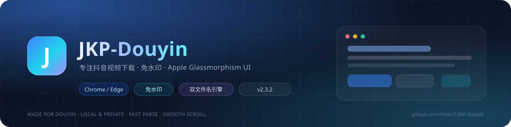
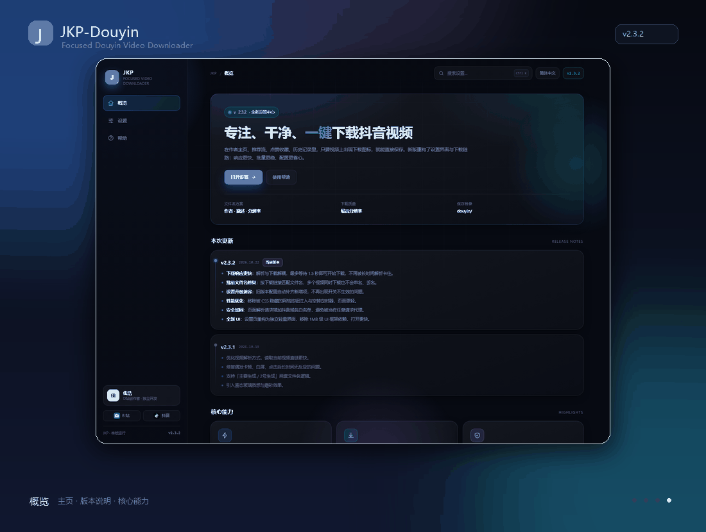
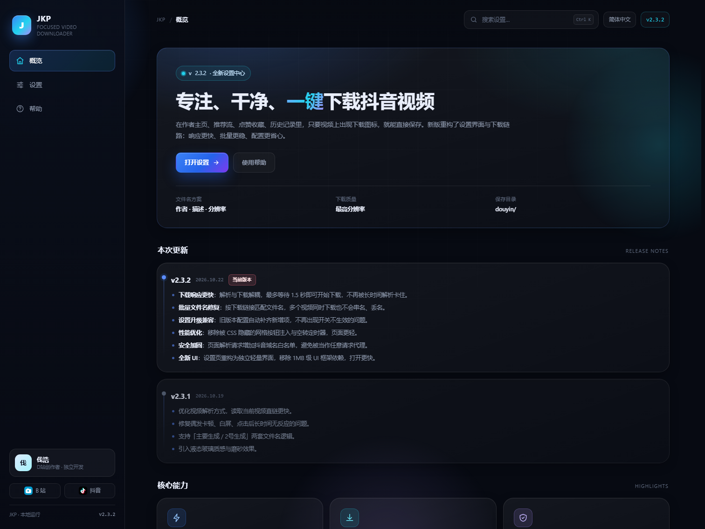
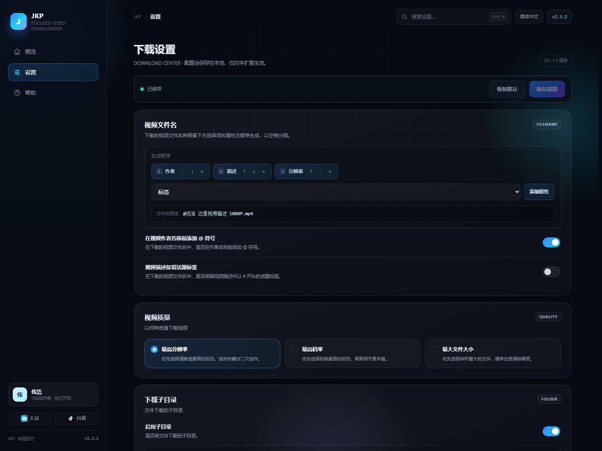
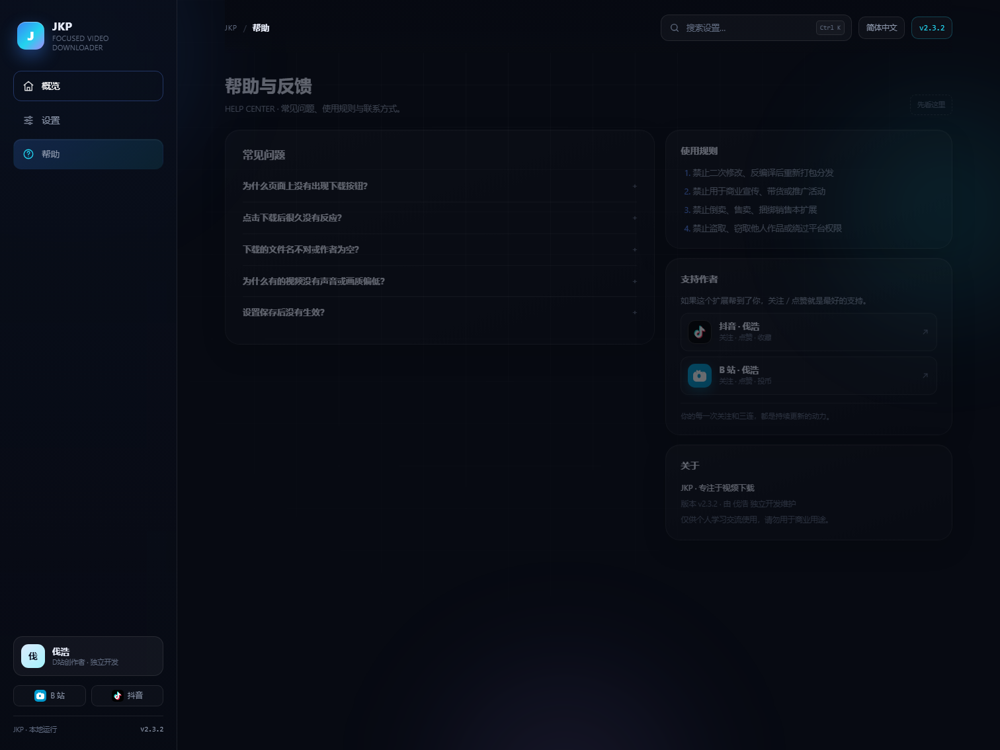

<div align="center">



<a href="https://github.com/XHazz1/JKP-Douyin/releases/latest">
  
</a>

<p>
  
  
  
  
</p>

<p>
  
  
  
  
  <a href="#-赞助支持"></a>
</p>

<p>
  
  
  
  
  
</p>

<br/>

<a href="https://github.com/XHazz1/JKP-Douyin/releases/latest">
  
</a>
<a href="https://github.com/XHazz1/JKP-Douyin">
  
</a>

</div>

---

<div align="center">

**刷抖音看到想收藏的视频？点一下就能免水印下载。**

全新 Apple Glassmorphism 设置界面 · 主要生成 / 2号生成双文件名引擎 · 解析更快 · 上下滚动更顺

</div>

<details open>
<summary><b>📖 目录</b></summary>

- ✨ 为什么选择 JKP-Douyin
- 🎬 动态预览
- 🖼 界面一览
- 🚀 核心能力
- 📦 安装教程
- ⚙️ 使用说明
- 🛡 权限与隐私
- 🗓 版本历史
- 🔥 本次更新 v2.3.2
- 📜 更新日志
- 📈 项目数据
- ❓ 常见问题
- 💖 支持作者
- ⚖️ 声明与禁止事项
- 🧋 赞助支持

</details>

## ✨ 为什么选择 JKP-Douyin

<table>
  <tr>
    <td align="center" width="33%">
      <h3>⚡ 极速解析</h3>
      <sub>页面数据与播放地址并行读取，最多 1.5 秒就开始下载，不再被长时间解析卡住</sub>
    </td>
    <td align="center" width="33%">
      <h3>🎬 免水印下载</h3>
      <sub>抖音视频、图集、作者主页、点赞收藏、历史记录，看到按钮就能一键保存</sub>
    </td>
    <td align="center" width="33%">
      <h3>🧩 双文件名引擎</h3>
      <sub>主要生成 / 2号生成两套逻辑，自动兜底；作者、描述、标签、分辨率、视频 ID 自由排序</sub>
    </td>
  </tr>
  <tr>
    <td align="center">
      <h3>🪟 Apple Glassmorphism</h3>
      <sub>独立轻量设置页：概览 / 设置 / 帮助，透明玻璃提示，官方品牌图标</sub>
    </td>
    <td align="center">
      <h3>🛞 丝滑滚动</h3>
      <sub>抖音页面滑动时暂停 DOM 扫描，设置页去除实时模糊与常驻动画</sub>
    </td>
    <td align="center">
      <h3>🔒 本地运行</h3>
      <sub>解析与设置都在浏览器本地完成，不上传账号、链接或下载记录</sub>
    </td>
  </tr>
</table>

## 🎬 动态预览

<div align="center">
  
  <br/>
  <sub>概览 → 设置 → 帮助 → 下载提示</sub>
</div>

## 🖼 界面一览

| 概览 | 设置 |
| :---: | :---: |
|  |  |

| 帮助 | 透明下载提示 |
| :---: | :---: |
|  |  |

## 🚀 核心能力

| 能力 | 说明 |
| :--- | :--- |
| 🎯 **一键下载** | 播放器悬停按钮 / 卡片下载图标，点击即可保存 |
| 🧬 **双解析引擎** | 页面详情 → 接口详情 → 内容脚本解析，逐级兜底 |
| 🏷 **文件名方案** | 作者 / 描述 / 标签 / 视频分辨率 / 视频 ID，自由排序与实时预览 |
| 🎚 **视频质量** | 最高分辨率 / 最高码率 / 最大文件大小 |
| 📁 **下载子目录** | 支持默认 `douyin/` 或自定义目录，自动校验非法字符 |
| 🔔 **下载提示** | 解析信息 / 开始下载 / 下载完成三类提示，可分别开关 |
| 🎨 **双文件名逻辑** | 主要生成 / 2号生成，切换后立即按新模式解析 |
| 🧠 **30 秒缓存** | 同一视频重复下载不再重复解析 |

## 📦 安装教程

1. 下载 **[JKP_2.3.2.zip](https://github.com/XHazz1/JKP-Douyin/releases/download/v2.3.2/JKP_2.3.2.zip)** 并解压；
2. 打开浏览器扩展管理页：

```text
Chrome  : chrome://extensions
Edge    : edge://extensions
Firefox : about:debugging#/runtime/this-firefox
```

3. 开启「开发者模式」（Firefox 选择「临时载入附加组件」）；
4. 点击「加载已解压的扩展程序」，选择解压出的文件夹（内含 `manifest.json` 的那一层）；
5. 打开抖音网页版，刷新页面即可使用。

> 也可以直接 `Code → Download ZIP` 下载本仓库源码，加载方式相同。

## ⚙️ 使用说明

- **视频文件名**：在设置页选择属性并调整顺序，下方会实时预览最终文件名；
- **视频质量**：三档可选，默认「最高分辨率」；
- **下载子目录**：开启后会按设置保存到 `douyin/` 或自定义文件夹；
- **下载提示**：可关闭解析 / 开始 / 完成提示；
- **文件名生成逻辑**：默认「主要生成」，识别不到作者/描述时切换到「2号生成」；
- **快捷键**：设置页支持 `Ctrl + S` 保存、`Ctrl + K` 搜索。

## 🛡 权限与隐私

| 权限 | 用途 |
| :--- | :--- |
| `downloads` | 保存视频 / 图集文件 |
| `webRequest` | 读取抖音请求参数，完成视频详情与播放地址解析 |
| `storage` | 保存设置与解析缓存 |
| `host_permissions` | 仅限抖音及其 CDN 域名（`douyin.com`、`douyinvod.com`、`snssdk.com` 等） |

本扩展不包含统计、不上传数据；所有设置与解析结果都保存在浏览器本地。

## 🗓 版本历史

| 版本 | 日期 | 主要变化 |
| :---: | :---: | :--- |
| **v2.3.2** | 2026.10.23 | 全新设置 UI、透明下载提示、双文件名逻辑/标签/子目录修复、滚动优化 |
| v2.3.1 | 2026.10.19 | 解析提速、稳定性修复、双文件名生成逻辑 |
| v2.3 | 2026.10.19 | 解析全面提速、移除推荐流卡片按钮 |
| v2.2 | 2026.10.15 | 推荐流卡片按钮、解析下载并行、设置页改版 |
| v2.1 | 早期 | 液态玻璃 UI、双文件名逻辑、30 秒缓存 |

> 本仓库从 **v2.3.2** 开始独立维护；v2.1 / v2.2 / v2.3 的官方归档见上游 Releases：
> [v2.3](https://github.com/HaoBaB521/JKP-Video-Downloader/releases/tag/v2.3) ·
> [v2.2](https://github.com/HaoBaB521/JKP-Video-Downloader/releases/tag/v2.2) ·
> [v2.1](https://github.com/HaoBaB521/JKP-Video-Downloader/releases/tag/v2.1)

## 🔥 本次更新 v2.3.2

### ✨ 新增
- 设置页重构为独立轻量界面：概览 / 设置 / 帮助三个页面
- 设置搜索、`Ctrl + S` 保存、未保存状态提示
- 实时文件名预览、保存路径预览
- 下载提示改为透明玻璃样式：标题 + 视频 ID 两级显示，解析中呼吸圆点
- 设置页新增官方品牌图标（抖音 / B 站）与「支持作者」区域

### ⚡ 优化
- 抖音页面上下滑动更顺：滚动时暂停 DOM 扫描，停止滚动后再恢复
- 设置页去掉实时高斯模糊与常驻漂浮动画，长页面滚动不再掉帧
- 解析与下载解耦：最多等 1.5 秒就开始下载，不再被长时间解析卡住
- 文件名生成详情按「页面详情 → 接口详情 → 内容脚本解析」顺序兜底
- 设置页移除 1.1MB 级 UI 框架依赖，打开速度明显更快

### 🐛 修复
- 「主要生成 / 2号生成」两套文件名逻辑都生效，切换后立即按新模式解析
- 文件名方案中的「标签」不生效
- 默认 `douyin/` 子目录不生效
- 快速下载路径不生成作者 / 描述文件名
- 批量下载时文件名可能串号 / 丢名
- 旧版本设置缺少新增字段时开关不生效

### 🧹 处理
- 删除旧 Vuetify 设置页（`chunks/options-BAaOQ2Xu.js`、`assets/options-BXj-kahd.css`）
- 移除被 CSS 隐藏的网格按钮注入与空转定时器
- 统一 README、版本号、发布说明与安装包命名
- 页面解析请求增加抖音域名白名单

## 📜 更新日志

### v2.3（2026.10.19）
- 优化：解析速度全面提速——视频信息和文件名“嗖”一下就出来
- 优化：播放源等待时间大幅缩短，点击下载响应更快
- 界面：移除推荐流卡片上的下载按钮，只保留播放器内悬停按钮
- 界面：联系作者窗口换用抖音、B 站官方图标
- 修复：修复无法生成视频文件名的问题
- 修复：修复下载按钮显示异常、多余挂载的问题
- 修复：修复部分视频解析慢、卡顿的问题

### v2.2（2026.10.15）
- 新增：首页推荐流视频卡片自动挂载下载按钮（`content-scripts/jkp_extra.js`）
- 新增：解析与下载并行，有播放地址立即下载
- 优化：视频详情 iframe 并发解析 1 → 2
- 优化：下载按钮改为全透明无边框样式
- 优化：设置页全新 Dashboard 风格改版
- 修复：manifest 注册 `jkp_extra.js`

### v2.1
- 全新液态玻璃 UI、全透明下载按钮
- 双重文件名生成逻辑
- 并行解析 + 30 秒缓存

## 📈 项目数据

<div align="center">
  
  
</div>

<div align="center">

[](https://star-history.com/#XHazz1/JKP-Douyin&Date)

</div>

## ❓ 常见问题

<details>
<summary><b>为什么页面上没有出现下载按钮？</b></summary>

确认当前页面是抖音网页版（`www.douyin.com`），并且内容已经加载完成；刚安装或刚更新后请刷新页面。
</details>

<details>
<summary><b>点击下载后很久没有反应？</b></summary>

新版最多等待 1.5 秒就会用当前播放地址开始下载，详情解析在后台继续；如果仍无响应，刷新页面重试，或切换「文件名生成逻辑」。
</details>

<details>
<summary><b>下载的文件名不对 / 作者为空？</b></summary>

在设置里调整「视频文件名」顺序，并尝试把「文件名生成逻辑」切换为「2号生成」；该模式会通过页面卡片元素重新定位作者与描述。
</details>

<details>
<summary><b>设置保存后没有生效？</b></summary>

设置保存在浏览器本地，刷新抖音页面后生效；扩展更新或重装后请重新保存一次。
</details>

## 💖 支持作者

如果这个扩展帮到了你，关注 / 点赞就是最好的支持：

- 抖音：[伐浩](https://www.douyin.com/user/MS4wLjABAAAApL6WdWT0Fi-l8bPuo5UpBDXhzYs0zC9i7V06NypCGmK4ZmO5GAKfSyHo_RYMsOm6?from_tab_name=main)
- B 站：[space.bilibili.com/493062255](https://space.bilibili.com/493062255)

## ⚖️ 声明与禁止事项

本扩展由作者独立开发，仅供个人学习、研究及技术交流使用。

未经作者明确授权，禁止将本扩展及其修改版本用于任何商业用途，包括但不限于收费、出售、付费引流或其他商业获利行为。

未经作者明确授权，禁止转载、二次分发、重新打包或以其他方式重新发布本扩展及其修改版本。

禁止冒用作者名义，或将本扩展及其修改版本冒充为他人原创进行传播。

禁止对本扩展进行修改、破解或逆向后，以未经作者授权的形式公开传播或用于商业获利。

禁止利用本扩展从事侵犯他人著作权、隐私权或其他违法违规的活动。

通过本扩展下载的视频仅供个人收藏与学习使用，请勿用于商业用途或二次传播。

## 🧋 赞助支持

<table>
<tr>
<td align="center" width="44%" valign="middle">


<p><b>打开支付宝，扫码请作者喝一杯珍珠奶茶</b></p>
<p><b>支付宝扫码</b> · 一杯 ¥6.60</p>

</td>
<td width="56%" valign="middle">

<p align="center"></p>

<h3 align="center">¥6.60 · 一杯珍珠奶茶</h3>

<p><b>✨ 6 块钱，不多，但能让茶宝开心一整天 ✨</b></p>

<ul>
<li>🧋 <b>一杯珍珠奶茶</b>：请作者喝一杯</li>
<li>🧱 <b>赞助者墙署名</b>：可选 GitHub ID</li>
<li>💬 <b>优先回复</b>：B 站 / Issues</li>
<li>🔓 <b>功能永久免费</b>：不锁任何功能</li>
</ul>

<blockquote>
🧡 <b>感谢每一位请茶宝喝奶茶的朋友，你们的名字会出现在赞助者墙。</b>
</blockquote>

</td>
</tr>
</table>

### 📱 三步请奶茶

| ① 扫码 | ② 备注 | ③ 上墙 |
| :---: | :---: | :---: |
| 扫旁边二维码，¥6.60 一杯 | 留言 GitHub ID / 昵称 | 加入赞助者墙 |

### 🧋 奶茶菜单

| 奶茶 | 金额 | 心意 |
| :---: | :---: | :--- |
| 🧋 珍珠奶茶 `推荐` | ¥6.60 | 赞助者墙署名 + 一句感谢 |
| 🍰 奶盖茶 | ¥20 | 以上 + 优先回复 |
| 🫖 一桶奶茶 | ¥50 | 以上 + 功能许愿优先 |
| 🎁 包场 | ¥100 | 以上 + 定制文件名规则 / 专属感谢 |

> 当前二维码为 **¥6.60 珍珠奶茶档**；想选其他奶茶，可在 B 站 / Issues 留言，我会单独发收款方式。赞助不是购买服务，扩展功能不会因为赞助而解锁或加锁。

### 🏆 赞助者墙

| 赞助者 | 留言 | 日期 |
| :---: | :--- | :---: |
| 虚位以待 | 第一位奶茶赞助者就是你 🧋 | — |

> 赞助后欢迎在 B 站 / Issues 留言你的 GitHub ID 或昵称，我会把你加到墙上（也可以匿名）。

### ❤️ 其他支持方式

- ⭐ **Star** 本仓库，让更多人看到
- 🍴 **Fork / 分享** 给需要的朋友
- 🐛 **提 Issue** 反馈问题或许愿功能
- 📺 **关注** 抖音 / B 站，第一时间看到更新

> 🧡 所有赞助都会用于维护扩展和买珍珠奶茶；谢谢你们。
---

<div align="center">


<sub>如果 <b>JKP-Douyin</b> 帮到了你，点一个 ⭐ Star 就是最大的支持</sub>

</div>
